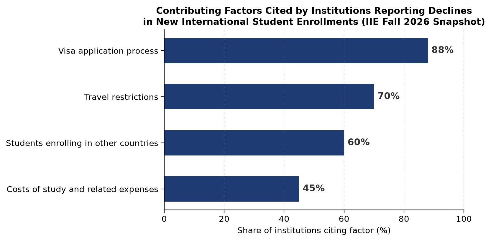
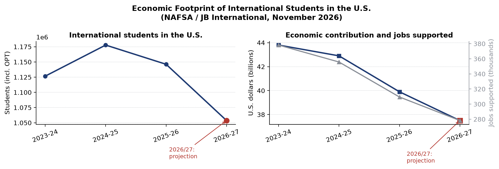

# From Growth to Decline: Policy Uncertainty and International Student Enrollment in U.S. Higher Education — Evidence from the Fall 2026 IIE Snapshot

**David Ayupov**
Independent policy research
November 2026

---

## Abstract

International student enrollment in U.S. higher education has shifted from sustained post-pandemic growth to a second consecutive year of decline. Drawing on the Institute of International Education (IIE) Fall 2026 Snapshot — a survey of 809 U.S. higher education institutions covering the 2026/27 academic year — this paper documents a 9% decline in total international student enrollment (including Optional Practical Training participants), a 15% decline in new international enrollments, and a 15% decline in graduate enrollment, alongside a 3% decline at the undergraduate level. The paper situates these movements within a rapidly evolving federal policy environment: the 2025 SEVIS record terminations affecting approximately 5,000 F-1 students; the Department of Homeland Security's final rule replacing "duration of status" with fixed four-year admission periods, which was preliminarily enjoined on September 14, 2026 and vacated as arbitrary and capricious on November 16, 2026; a proposed rule imposing $70,000/$30,000 institutional fees on Optional Practical Training; and a contested narrowing of Curricular Practical Training eligibility that is currently the subject of federal litigation. The analysis distinguishes carefully between (i) observed enrollment declines, (ii) institutional attributions of those declines, and (iii) scenario-based economic projections, arguing that the unifying mechanism behind all three policy episodes is regulatory uncertainty spanning the entire student lifecycle — admission, retention, practical training, and post-graduation employment. NAFSA estimates that international students contributed $39.9 billion and supported 309,409 U.S. jobs in 2025/26, with projected losses for 2026/27 on the order of $2.4 billion. The paper concludes that the observed decline is best understood not as a revealed preference against U.S. education but as a rational response to elevated policy risk, and outlines an agenda for causal identification that current survey instruments cannot support.

**Keywords:** international students; F-1 visas; higher education policy; Optional Practical Training; SEVIS; immigration regulation; policy uncertainty; human capital mobility

**JEL Classification:** F22 (International Migration); I23 (Higher Education); J61 (Geographic Labor Mobility); K37 (Immigration Law)

---

## 1. Introduction

The United States has long been the world's leading destination for internationally mobile students, and the economic and strategic stakes of that position are substantial. International students accounted for approximately 6% of total U.S. higher education enrollment in 2024/25 ([Open Doors 2025](https://opendoorsdata.org/wp-content/uploads/2025/11/OD25_Fast-Facts.pdf)), and NAFSA: Association of International Educators estimates that their spending contributed $39.9 billion to the U.S. economy and supported 309,409 jobs in the 2025/26 academic year alone ([NAFSA, 2026](https://www.nafsa.org/about/about-nafsa/international-students-contributed-399-billion-us-economy-2025-2026-fall-2026)).

That position is now under measurable strain. After four consecutive years of growth culminating in a record 1,177,766 international students in 2024/25 ([Open Doors 2025](https://opendoorsdata.org/wp-content/uploads/2025/11/OD25_Fast-Facts.pdf)), total enrollment fell 2.7% to 1,146,163 in 2025/26 ([Higher Ed Dive, 2026](https://www.highereddive.com/news/international-student-enrollment-fell-27-in-2025-26/874661/)). Preliminary data for the current 2026/27 academic year indicate that the contraction is accelerating rather than stabilizing.

This paper makes three contributions. First, it provides a precise, internally consistent reading of the most recent enrollment evidence — the IIE Fall 2026 Snapshot — with explicit attention to what each indicator does and does not measure (Section 3). Second, it reconstructs the 2025–2026 federal policy sequence across four distinct regulatory fronts — SEVIS record terminations, fixed admission periods, proposed OPT fees, and CPT reinterpretation — carefully classifying each measure by its actual legal status as of November 17, 2026, since public discussion routinely conflates final rules with proposals and enjoined measures with vacated ones (Section 4). Third, it develops an analytical framework — lifecycle-spanning policy uncertainty — that integrates the enrollment data, the institutional attributions, and the economic projections into a single coherent account, while being explicit about the inferential limits of each evidence type (Sections 5–7).

The central argument is as follows: the enrollment decline documented for fall 2026 is real, large, and concentrated in new enrollments and graduate programs; institutions overwhelmingly attribute it to visa processing and travel restrictions; and the four policy episodes of 2025–2026, whatever their individual outcomes in court, jointly raised the perceived risk of the entire U.S. study pathway. The decline is therefore best understood as a rational institutional and individual response to uncertainty rather than a stable new equilibrium of revealed preferences.

## 2. Data and Methods

This is a documentary and descriptive analytical study. Three classes of sources are used, each with distinct evidentiary standing:

1. **Survey statistics.** The IIE Fall 2026 Snapshot on International Student Enrollment, conducted by IIE with ten partner higher education associations, covers 809 U.S. institutions and reports enrollment changes for the 2026/27 academic year ([IIE, 2026](https://opendoorsdata.org/wp-content/uploads/2026/11/IIE_Fall-Snapshot_2026_Key-Findings_2026.pdf)). It is a subset of the nearly 3,000 institutions surveyed annually for Open Doors; the full national picture for 2026/27 will only be available with Open Doors 2027. Historical baselines come from Open Doors 2025 and the IIE Fall 2025 Snapshot ([Open Doors 2025](https://opendoorsdata.org/wp-content/uploads/2025/11/OD25_Fast-Facts.pdf); [IIE Fall 2025 Snapshot](https://opendoorsdata.org/wp-content/uploads/2025/11/IIE_Fall-2025-Snapshot_Key-Findings.pdf)).
2. **Primary regulatory documents.** Federal Register notices, DHS/ICE publications, and court records, including the fixed-period-of-admission final rule and its litigation history, the OPT fee notice of proposed rulemaking (91 FR 64566), and the SEVP broadcast messages on CPT ([Federal Register, 2026](https://www.federalregister.gov/documents/2026/10/08/2026-20660/optional-practical-training-fees); [Study in the States, 2026](https://studyinthestates.dhs.gov/2026/07/dhs-publishes-final-rule-establishing-a-fixed-time-period-of-admission-and-an-extension-of); [AAU, 2026](https://www.aau.edu/resource-library/resources-on-legal-action-by-aau-and-other-educational-organizations-in-response-to-changes-to-the-curricular-practical-training-cpt-for-international-students)).
3. **Economic estimates.** NAFSA/JB International analyses of international students' economic contribution, and scenario projections of the fiscal consequences of enrollment decline ([NAFSA, 2026](https://www.nafsa.org/about/about-nafsa/international-students-contributed-399-billion-us-economy-2025-2026-fall-2026); [NAFSA Fall 2026 analysis](https://www.nafsa.org/sites/default/files/media/document/Fall%202026%20International%20Student%20Enrollment%20Snapshot%20Economic%20Impact%20Overview%20FINAL_0.pdf)).

Because the Snapshot's public key-findings document does not disclose sampling weights, participation history, or confidence intervals, all figures reported here should be read as preliminary institutional survey results rather than final national statistics. Where stakeholder-authored sources (university associations, advocacy organizations) are used for litigation facts, they are identified as such.

## 3. Enrollment Dynamics: What the Fall 2026 Data Show

### 3.1 Headline results

The Fall 2026 Snapshot reports the following year-over-year changes across its 809 participating institutions ([IIE, 2026](https://opendoorsdata.org/wp-content/uploads/2026/11/IIE_Fall-Snapshot_2026_Key-Findings_2026.pdf)):

| Measure | Change, 2026/27 |
|---|---:|
| Total international students (enrolled + OPT) | **−9%** |
| New international student enrollments | **−15%** |
| Undergraduate students | **−3%** |
| Graduate students | **−15%** |
| OPT participants | **−6%** |

Three clarifications are essential for correct interpretation.

**First, the total measure includes OPT participants.** The 9% decline covers both students in classes and those on post-completion practical training. It is therefore imprecise to describe it as a decline in students "in classrooms."

**Second, new enrollments are a flow, not an addition to the stock.** The 15% decline in new international students — those studying at their institution for the first time — and the 9% decline in the total stock cannot be summed or directly compared; they measure different objects. The stock decline is smaller than the intake decline because continuing students and OPT participants cushion the aggregate figure. The fact that intake is falling roughly one-and-a-half times faster than the stock implies that, absent reversal, the aggregate decline will deepen in future years as smaller cohorts replace larger ones.

**Third, the decline is concentrated at the graduate level.** Graduate enrollment fell 15%, five times the undergraduate rate of decline. This asymmetry matters for two reasons: graduate programs carry the heaviest tuition cross-subsidies at many research universities, and graduate cohorts are disproportionately reliant on the practical-training pathway (OPT/CPT) that current policy proposals target.

### 3.2 The trajectory: two consecutive years of contraction

The fall 2026 decline did not emerge from a vacuum. The sequence of recent data points is:

| Academic year | Total international students | Change | Source |
|---|---:|---:|---|
| 2022/23 | 1,057,018 | +12% | Open Doors 2023 |
| 2023/24 | 1,126,690 | +7% | Open Doors 2024 |
| 2024/25 | 1,177,766 | +5% | [Open Doors 2025](https://opendoorsdata.org/wp-content/uploads/2025/11/OD25_Fast-Facts.pdf) |
| 2025/26 | 1,146,163 | −2.7% | [Open Doors 2026, via Higher Ed Dive](https://www.highereddive.com/news/international-student-enrollment-fell-27-in-2025-26/874661/) |
| 2026/27 (preliminary) | n/a (−9% among 809 institutions) | — | [IIE Fall 2026 Snapshot](https://opendoorsdata.org/wp-content/uploads/2026/11/IIE_Fall-Snapshot_2026_Key-Findings_2026.pdf) |

The inflection is sharp: four years of growth at decelerating rates, followed by a small aggregate decline in 2025/26 that was driven by a 17% collapse in new enrollments ([IIE Fall 2025 Snapshot](https://opendoorsdata.org/wp-content/uploads/2025/11/IIE_Fall-2025-Snapshot_Key-Findings.pdf)), and now a much broader decline in 2026/27 that extends to the total stock, graduate programs, and OPT. The leading indicators (new enrollment) have been negative for longer and more deeply than the lagging ones (total stock) — the classic signature of an ongoing intake shock propagating through the system.

## 4. The Policy Landscape, 2025–2026

Four distinct regulatory developments bear directly on the F-1 student lifecycle. They differ fundamentally in legal status, and precision about that status is a prerequisite for sound analysis.

### 4.1 The 2025 SEVIS terminations

In spring 2025, U.S. Immigration and Customs Enforcement (ICE) terminated the SEVIS records of approximately 5,000 F-1 students; in more than 3,000 of these cases, the Department of State had first revoked the student's visa ([American Immigration Council, 2026](https://www.americanimmigrationcouncil.org/blog/trump-targets-f-1-students-turmoil)). The terminations were abrupt — many students learned of them only upon checking their status — and triggered at least 65 federal lawsuits ([Inside Higher Ed, 2025](https://www.insidehighered.com/news/global/international-students-us/2025/04/24/international-student-lawsuits-result-restored)). Courts granted temporary restraining orders in dozens of cases, and in late April 2025 ICE restored many records retroactively, in some instances before receiving a court order ([American Immigration Council, 2026](https://www.americanimmigrationcouncil.org/blog/trump-targets-f-1-students-turmoil)).

The episode matters analytically for two reasons beyond the immediate harm. First, it demonstrated that the administrative infrastructure of student status — a database record — could be terminated without notice, and that restoration required litigation. Second, although the records were largely restored, the underlying termination authority was not judicially foreclosed, leaving the mechanism available for future use. The episode therefore functions as an uncertainty shock: its expected cost to any given student rose even though its realized harm was eventually reversed for most affected individuals.

### 4.2 The fixed-period-of-admission rule: enjoined, then vacated

On July 17, 2026, DHS published a final rule, "Establishing a Fixed Time Period of Admission and an Extension of Stay Procedure for Nonimmigrant Academic Students, Exchange Visitors, and Representatives of Foreign Information Media," which would have replaced the decades-old "duration of status" (D/S) framework with fixed admission periods capped at four years for F-1 students ([Study in the States, 2026](https://studyinthestates.dhs.gov/2026/07/dhs-publishes-final-rule-establishing-a-fixed-time-period-of-admission-and-an-extension-of)). The rule also would have reduced the F-1 grace period from 60 to 30 days and introduced a formal extension-of-stay process for students needing more time ([Study in the States FAQ](https://studyinthestates.dhs.gov/final-rule-establishing-a-fixed-time-period-of-admission-and-an-extension-of-stay-procedure-faq)).

One day before its September 15, 2026 effective date, Judge F. Dennis Saylor IV of the U.S. District Court for the District of Massachusetts issued nationwide preliminary relief in *Presidents' Alliance on Higher Education and Immigration v. DHS*, postponing the rule's effective date under Section 705 of the Administrative Procedure Act ([BAL Immigration News, 2026](https://www.bal.com/immigration-news/united-states-federal-court-blocks-dhs-duration-of-status-final-rule-before-effective-date/)). On November 16, 2026, Judge Saylor went further and vacated the rule outright, finding it arbitrary and capricious because DHS failed to appropriately weigh the rule's costs and benefits ([Politico, 2026](https://www.politico.com/news/2026/11/16/judge-tosses-limits-foreign-students-study-us-01168681); [Bloomberg Law, 2026](https://news.bloomberglaw.com/social-justice/dhs-restrictions-on-f-1-foreign-students-stay-in-us-overturned)).

Two interpretive points deserve emphasis. First, the rule never imposed a blanket four-year limit on study; students needing longer could apply for extensions. Its substantive effect was to shift the default from "stay as long as you maintain status" to "stay until a fixed date unless DHS grants more." Second, as of this writing the D/S framework remains in force nationwide — the vacatur, while subject to potential appeal, means the most disruptive structural change to student admissions in decades is currently without legal effect.

### 4.3 The proposed OPT fees: $70,000 per initial recommendation

On October 8, 2026, DHS published a notice of proposed rulemaking, "Optional Practical Training Fees" (91 FR 64566), which would require SEVP-certified institutions to pay $70,000 for each F-1 student they initially recommend for Optional Practical Training, and $30,000 for any subsequent OPT recommendation ([Federal Register, 2026](https://www.federalregister.gov/documents/2026/10/08/2026-20660/optional-practical-training-fees); [DHS, 2026](https://www.dhs.gov/news/2026/10/07/dhs-proposes-fees-foreign-student-work-program-protect-american-jobs)). DHS frames the fees as an anti-fraud and worker-protection measure; the agency acknowledges that institutions may pass the cost on to students, all students, or employers ([AAU comments, 2026](https://www.aau.edu/resource-library/aau-comments-on-optional-practical-training-fees)).

The 30-day comment period closed on November 9, 2026 with 3,473 comments received. Opposition was unusually broad, spanning organizations rarely found on the same side of an immigration rulemaking: the Association of American Universities, NAFSA, the American Council on Education, the AAMC, Columbia University, the U.S. Chamber of Commerce, the Economic Policy Institute, and the Economic Innovation Group all urged withdrawal ([AAU, 2026](https://www.aau.edu/resource-library/aau-comments-on-optional-practical-training-fees); [NAFSA, 2026](https://www.nafsa.org/regulatory-information/nafsa-comment-letter-dhs-proposed-opt-fee-rule); [U.S. Chamber, 2026](https://www.uschamber.com/immigration/comment-on-ice-nprm-imposing-fees-of-70-000-100-000-on-optional-practical-training-opt); [EPI, 2026](https://www.epi.org/publication/epi-comment-on-ice-proposed-rule-to-create-a-new-fee-for-the-optional-practical-training-program/)).

Critically for causal inference (Section 7), this is a proposal, not a final rule. No fee is currently payable. Its enrollment effects — if any materialize before finalization — would operate entirely through expectations.

### 4.4 The CPT reinterpretation: guidance in effect, litigation pending

On August 12 and August 24, 2026, ICE's Student and Exchange Visitor Program issued two Broadcast Messages (2608-01 and 2608-02) announcing a sharply narrower interpretation of Curricular Practical Training: designated school officials may authorize CPT only when the practical training is required of all students in the degree program, effectively disqualifying elective internships taken for credit — a departure from the interpretation the government had maintained for more than 35 years ([AAU, 2026](https://www.aau.edu/resource-library/resources-on-legal-action-by-aau-and-other-educational-organizations-in-response-to-changes-to-the-curricular-practical-training-cpt-for-international-students); [NAFSA, 2026](https://www.nafsa.org/legal-defense-CPT)).

On October 5, 2026, AAU, the Presidents' Alliance on Higher Education and Immigration, NAFSA, and AICUM sued in the U.S. District Court for the District of Massachusetts (*Association of American Universities v. DHS*, No. 1:26-cv-14520), arguing the Broadcast Messages violate the APA as arbitrary and capricious, impermissibly retroactive, contrary to law, and procedurally invalid ([Bloomberg Law, 2026](https://news.bloomberglaw.com/health-law-and-business/ice-policy-tightening-student-work-option-challenged-by-colleges); [AAU, 2026](https://www.aau.edu/resource-library/resources-on-legal-action-by-aau-and-other-educational-organizations-in-response-to-changes-to-the-curricular-practical-training-cpt-for-international-students)). A preliminary injunction hearing was held November 6, 2026. Unlike the fixed-period rule, the new CPT interpretation remains in effect while the litigation proceeds — several institutions, including UC Berkeley and UC Davis, paused course-credit CPT authorizations in response ([Economic Times, 2026](http://economictimes.indiatimes.com/nri/study/uc-berkeley-uc-davis-pause-course-credit-cpt-applications-after-ice-warning/articleshow/133555697.cms)).

### 4.5 Synthesis: a lifecycle-wide uncertainty shock

Table 2 classifies the four measures by legal status as of November 17, 2026:

| Measure | Instrument | Status as of Nov 17, 2026 | Stage of lifecycle affected |
|---|---|---|---|
| SEVIS terminations (2025) | Administrative action | Largely reversed after litigation; authority contested | Active study / work authorization |
| Fixed 4-year admission periods | Final rule (Jul 17, 2026) | **Vacated** Nov 16, 2026 (appeal possible) | Length of stay |
| OPT fees ($70k/$30k) | Proposed rule (Oct 8, 2026) | Proposal only; comments closed Nov 9 | Post-graduation employment |
| CPT narrowing | SEVP Broadcast Messages (Aug 2026) | **In effect**; PI hearing held Nov 6 | In-study practical training |

No single measure currently makes it unlawful or impracticable to study in the United States. But across the four fronts, every stage of the international student lifecycle — entry, retention, in-study work, and post-graduation work — was subject to an adverse regulatory development within an eighteen-month window. This is the analytical core of the uncertainty mechanism developed in Section 6.

## 5. Institutional Attributions and Responses

### 5.1 Why institutions say enrollment fell

Among the institutions in the Snapshot that reported declines in new international enrollments, the contributing factors cited were ([IIE, 2026](https://opendoorsdata.org/wp-content/uploads/2026/11/IIE_Fall-Snapshot_2026_Key-Findings_2026.pdf)):

| Factor | Institutions citing |
|---|---:|
| Visa application process | 88% |
| Travel restrictions | 70% |
| Students enrolling in other countries | 60% |
| Costs | 45% |

These figures require careful handling. The 88% figure means that 88% of the institutions experiencing new-enrollment declines identified the visa process as a contributing factor — not that visas explain 88% of the decline. Institutions could cite multiple factors. Nor are these the results of surveying the students who declined to enroll; they are institutional assessments of a population whose decision margins are unobserved.

Still, the pattern is informative. The two most-cited factors — visa processing and travel restrictions — are precisely the mechanisms through which the 2025 SEVIS episode and the broader enforcement posture would be expected to operate. And the third factor, enrollment in other countries, is the competitive margin: 60% of declining institutions report losing students to other destinations, consistent with the 95% of all responding institutions who said international students would likely consider other countries if OPT options were limited ([IIE, 2026](https://opendoorsdata.org/wp-content/uploads/2026/11/IIE_Fall-Snapshot_2026_Key-Findings_2026.pdf)).

### 5.2 Institutions are not retreating from international recruitment

The decline is occurring against a backdrop of continued institutional commitment. In the same Snapshot, 81% of institutions identified international student recruitment as a priority, 91% prioritized STEM fields, and the leading recruitment targets were Vietnam, India, and Brazil at the undergraduate level and India, Vietnam, and Nepal at the graduate level ([IIE, 2026](https://opendoorsdata.org/wp-content/uploads/2026/11/IIE_Fall-Snapshot_2026_Key-Findings_2026.pdf)). The persistence of recruitment effort alongside falling enrollment reinforces the interpretation that the binding constraint lies in the pipeline — visas, travel, and perceived risk — rather than in institutional willingness to enroll.

There is also a notable tension: institutions prioritize STEM recruitment (91%; 99% among institutions with over 10,000 students), while the policy changes of 2025–2026 disproportionately affect precisely the STEM talent pipeline that depends on CPT/OPT pathways for practical experience and employer access. NAFSA's issue brief estimates that losing one-third of international students in U.S. STEM fields would cause long-term GDP losses of $240–481 billion per year ([NAFSA issue brief, 2026](https://www.nafsa.org/issue-brief-america-losing-international-student-talent)) — a scenario estimate, not a forecast, but indicative of the stakes.

## 6. Economic Dimensions

### 6.1 Measured contributions and measured losses

NAFSA and JB International estimate that international students contributed $42.9 billion and supported 355,736 jobs in 2024/25, falling to $39.9 billion and 309,409 jobs in 2025/26 — a 7% ($3 billion) decline in spending and over 46,000 jobs lost year-over-year ([NAFSA, 2026](https://www.nafsa.org/about/about-nafsa/international-students-contributed-399-billion-us-economy-2025-2026-fall-2026)). For 2026/27, based on the Fall 2026 Snapshot enrollment figures, NAFSA projects a further decline to $37.5 billion and 278,208 jobs ([NAFSA Fall 2026 analysis](https://www.nafsa.org/sites/default/files/media/document/Fall%202026%20International%20Student%20Enrollment%20Snapshot%20Economic%20Impact%20Overview%20FINAL_0.pdf)); press coverage of the release frames the projected loss at roughly $2.4 billion for the year ([CNBC, 2026](https://www.cnbc.com/2026/11/16/international-student-enrollment-decline-us-colleges.html)). NAFSA's methodology estimates one U.S. job created or supported for every three international students, derived from spending in higher education, accommodation, dining, retail, transportation, telecommunications, and health insurance ([NAFSA methodology](https://www.nafsa.org/sites/default/files/media/document/NAFSA_Methodology_Economic_Value_2025_FINAL%5B1%5D.pdf)).

### 6.2 Scenario estimates versus realized losses

Two classes of economic figures circulate in this debate and must not be conflated. The first is realized, historical contribution ($39.9 billion in 2025/26). The second is scenario modeling: the American Immigration Council, citing research by the Economic Innovation Group and economist Michael Clemens, reports that a sustained 10% decline in F-1 enrollment could reduce U.S. GDP by $72–145 billion over a decade ([American Immigration Council, 2026](https://www.americanimmigrationcouncil.org/blog/trump-targets-f-1-students-turmoil)). This is a conditional projection under a specific counterfactual, not a tally of losses already incurred, and it should not be mechanically attached to the 9% Snapshot decline — the two figures differ in scope, horizon, and construction.

The honest summary is: measured losses so far are in the low billions of dollars per year; scenario losses under sustained decline are an order of magnitude larger; and the difference between the two is precisely the policy choice margin that the next several years will determine.

## 7. Interpretation: The Uncertainty Mechanism, and the Limits of What We Can Claim

### 7.1 Why uncertainty is the unifying explanation

A prospective international student weighs a multi-year, largely irreversible investment: application costs, forgone alternatives in Canada, the UK, Australia, or Europe, and — critically — the expectation of completing the intended program and obtaining the practical experience that motivates much international study. The 2025–2026 policy sequence degraded expected value at every node of that decision tree simultaneously: status security (SEVIS), program completion horizon (fixed admission periods), in-study work (CPT), and post-graduation work (OPT fees).

Under any standard model of investment under uncertainty, the rational response to a widening distribution of bad outcomes — even with the expected value held constant — is to defer or redirect. This mechanism is consistent with all three observed patterns: the concentration of the decline in new enrollments (the margin where the decision to come is being made), the institutional attribution to visas and travel (the channels through which risk is experienced), and the reported loss of students to other countries (the substitute margin).

### 7.2 What the data cannot yet establish

Intellectual honesty requires stating the inferential limits:

1. **No causal decomposition exists.** The Snapshot measures enrollment changes and asks institutions why they occurred. It cannot separate how much of the decline reflects visa refusals, deferred decisions, redirection to other countries, or price effects. The 88%/70%/60%/45% figures are institutional attributions, not estimated effect shares.
2. **The survey is a subset.** 809 institutions is a large sample but not the full Open Doors universe of nearly 3,000; compositional change between survey waves is not publicly documented, and no confidence intervals are published. The national 2026/27 figures may differ.
3. **Timing complicates attribution.** Fall 2026 enrollment decisions were substantially made before the OPT fee proposal was published on October 8, 2026. The proposal cannot have caused the fall 2026 intake decline; its effects, if any, will appear in 2027/28 decisions. Conversely, the SEVIS episode (spring 2025) and the fixed-period rule (published July 2026, litigated through the fall) plausibly did overlap the relevant decision windows.
4. **Advocacy-source asymmetry.** Much of the litigation detail available in accessible sources comes from organizations that are parties or aligned with the challengers. Court outcomes cited here (the September 14 postponement, the November 16 vacatur) are matters of record, but characterizations of harms by plaintiff organizations are self-reports.

## 8. Conclusion

The evidence assembled here supports four conclusions. First, the contraction of international student enrollment in U.S. higher education is real, accelerating, and concentrated in the intake margins — new students and graduate programs — that determine the future stock. Second, the proximate causes institutions identify — visa processing and travel restrictions — are exactly the channels through which the 2025–2026 enforcement and regulatory posture would be predicted to operate, lending coherence, though not proof, to the policy-attribution narrative. Third, the policy environment itself remains unsettled: of the four major measures examined, one (SEVIS terminations) was largely reversed under litigation pressure, one (fixed admission periods) was vacated by a federal court on November 16, 2026, one (OPT fees) remains only a proposal, and one (CPT narrowing) is in effect but under active judicial challenge. Fourth, the economic stakes are large and quantified: $39.9 billion and roughly 310,000 jobs in 2025/26, with multi-billion-dollar annual losses projected as the decline propagates.

The strategic question for U.S. higher education and policymakers is therefore not whether individual measures survive judicial review, but whether the cumulative signal — that the rules governing international study in the United States can change abruptly, retroactively, and without notice — becomes a durable feature of the destination's reputation. Enrollment systems respond slowly; reputations for unpredictability, once established, respond even more slowly. The data presented here are the earliest comprehensive reading of that process in motion.

---

## References

1. Institute of International Education. (2026). *Fall 2026 Snapshot on International Student Enrollment: Key Findings.* https://opendoorsdata.org/wp-content/uploads/2026/11/IIE_Fall-Snapshot_2026_Key-Findings_2026.pdf
2. Institute of International Education. (2025). *Open Doors 2025: Fast Facts.* https://opendoorsdata.org/wp-content/uploads/2025/11/OD25_Fast-Facts.pdf
3. Institute of International Education. (2025). *Fall 2025 Snapshot on International Student Enrollment: Key Findings.* https://opendoorsdata.org/wp-content/uploads/2025/11/IIE_Fall-2025-Snapshot_Key-Findings.pdf
4. Higher Ed Dive. (2026, November 16). *International student enrollment fell 2.7% in 2025-26.* https://www.highereddive.com/news/international-student-enrollment-fell-27-in-2025-26/874661/
5. Department of Homeland Security. (2026, July 17). *Final Rule: Establishing a Fixed Time Period of Admission and an Extension of Stay Procedure.* Study in the States. https://studyinthestates.dhs.gov/2026/07/dhs-publishes-final-rule-establishing-a-fixed-time-period-of-admission-and-an-extension-of
6. Study in the States. (2026). *Elimination of Duration of Status FAQ.* https://studyinthestates.dhs.gov/final-rule-establishing-a-fixed-time-period-of-admission-and-an-extension-of-stay-procedure-faq
7. BAL Immigration News. (2026). *Federal court blocks DHS "duration of status" final rule before effective date.* https://www.bal.com/immigration-news/united-states-federal-court-blocks-dhs-duration-of-status-final-rule-before-effective-date/
8. Politico. (2026, November 16). *Judge tosses DHS rule limiting how long foreign students can study in US.* https://www.politico.com/news/2026/11/16/judge-tosses-limits-foreign-students-study-us-01168681
9. Bloomberg Law. (2026, November 16). *DHS restrictions on F-1 foreign students' stay in US overturned.* https://news.bloomberglaw.com/social-justice/dhs-restrictions-on-f-1-foreign-students-stay-in-us-overturned
10. Department of Homeland Security. (2026, October 8). *Optional Practical Training Fees* [Notice of proposed rulemaking, 91 FR 64566]. Federal Register. https://www.federalregister.gov/documents/2026/10/08/2026-20660/optional-practical-training-fees
11. Department of Homeland Security. (2026, October 7). *DHS proposes fees for foreign student work program to protect American jobs.* https://www.dhs.gov/news/2026/10/07/dhs-proposes-fees-foreign-student-work-program-protect-american-jobs
12. Association of American Universities. (2026). *Comments on Optional Practical Training Fees.* https://www.aau.edu/resource-library/aau-comments-on-optional-practical-training-fees
13. NAFSA. (2026). *Comment letter on DHS proposed OPT fee rule.* https://www.nafsa.org/regulatory-information/nafsa-comment-letter-dhs-proposed-opt-fee-rule
14. U.S. Chamber of Commerce. (2026). *Comment on ICE NPRM imposing fees of $70,000/$100,000 on OPT.* https://www.uschamber.com/immigration/comment-on-ice-nprm-imposing-fees-of-70-000-100-000-on-optional-practical-training-opt
15. Economic Policy Institute. (2026). *EPI comment on ICE proposed rule to create a new fee for the OPT program.* https://www.epi.org/publication/epi-comment-on-ice-proposed-rule-to-create-a-new-fee-for-the-optional-practical-training-program/
16. Association of American Universities. (2026). *Resources on legal action by AAU and other educational organizations in response to changes to CPT.* https://www.aau.edu/resource-library/resources-on-legal-action-by-aau-and-other-educational-organizations-in-response-to-changes-to-the-curricular-practical-training-cpt-for-international-students
17. NAFSA. (2026). *Legal challenge to the broadcast messages regarding Curricular Practical Training.* https://www.nafsa.org/legal-defense-CPT
18. Bloomberg Law. (2026, October 6). *ICE policy tightening student work option challenged by colleges.* https://news.bloomberglaw.com/health-law-and-business/ice-policy-tightening-student-work-option-challenged-by-colleges
19. Economic Times. (2026). *UC Berkeley, UC Davis pause course-credit CPT applications after ICE warning.* http://economictimes.indiatimes.com/nri/study/uc-berkeley-uc-davis-pause-course-credit-cpt-applications-after-ice-warning/articleshow/133555697.cms
20. American Immigration Council. (2026, November). *Trump administration targets F-1 students, creating turmoil for them, US universities, and US employers.* https://www.americanimmigrationcouncil.org/blog/trump-targets-f-1-students-turmoil
21. Inside Higher Ed. (2025, April 24). *International student lawsuits result in restored SEVIS records.* https://www.insidehighered.com/news/global/international-students-us/2025/04/24/international-student-lawsuits-result-restored
22. NAFSA. (2026, November 16). *International students contributed $39.9 billion to the U.S. economy in 2025-2026.* https://www.nafsa.org/about/about-nafsa/international-students-contributed-399-billion-us-economy-2025-2026-fall-2026
23. NAFSA. (2026). *Fall 2026 International Student Enrollment Snapshot & Economic Impact Overview.* https://www.nafsa.org/sites/default/files/media/document/Fall%202026%20International%20Student%20Enrollment%20Snapshot%20Economic%20Impact%20Overview%20FINAL_0.pdf
24. NAFSA. (2026). *America is losing international student talent* [Issue brief]. https://www.nafsa.org/issue-brief-america-losing-international-student-talent
25. NAFSA. (2025). *The economic value of international student enrollment: Methodology.* https://www.nafsa.org/sites/default/files/media/document/NAFSA_Methodology_Economic_Value_2025_FINAL%5B1%5D.pdf
26. CNBC. (2026, November 16). *International student enrollment drops sharply, putting more U.S. colleges in financial jeopardy.* https://www.cnbc.com/2026/11/16/international-student-enrollment-decline-us-colleges.html

---

*Data current as of November 17, 2026. All figures traceable to primary sources cited above; machine-readable copies of the underlying data are provided in the `data/` directory of this repository, and all figures are reproducible via `analysis/make_figures.py`.*
